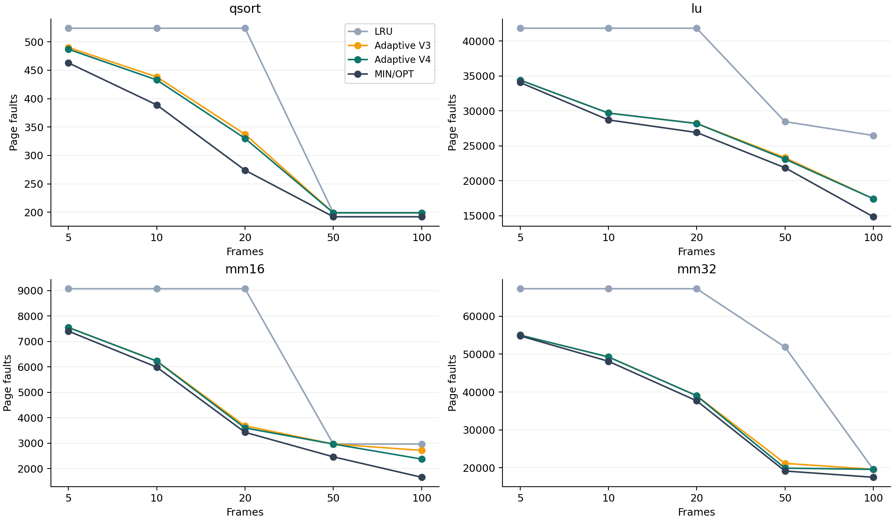
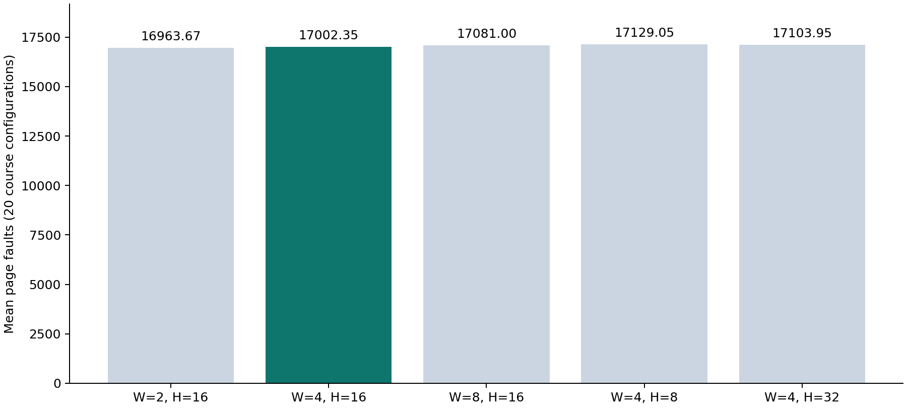
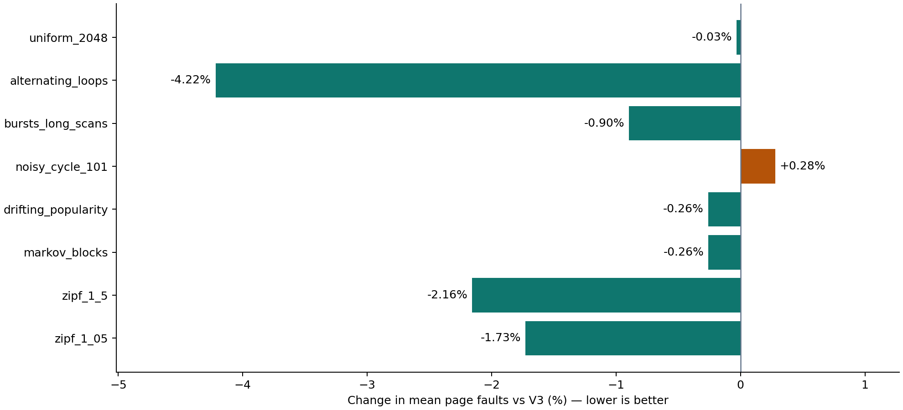

# Adaptive V4：在线页面替换与现场验证报告

当前默认 **Adaptive V4** 在四条课程轨迹、五档页框的 20 个配置上，平均缺页次数为 **17,002.35**，比 LRU 少 **30.43%**，比队友的 V3 再少 **0.576%**。相对于 V3，**15 个配置改善、5 个持平、0 个退化**。V3 原本已经很强，这轮改进幅度应按实际数字理解。

现场运行：`bash run.sh 老师给的文件.txt`。完整操作见 [现场说明](QUICKSTART.md)，[汇报 PPT](presentation/contest-v4.pptx)，[讲稿与答辩](presentation/V4_SPEAKER_NOTES.md)。历史结果留在 [V3 报告](REPORT_V3.md)，本报告所有新数据在 [results/v4](results/v4/)。

## 1. 模型、输入和评分

Demand paging，空内存启动，命中不替换；缺页先用空页框，满时淘汰一个驻留页并装入当前请求页。没有预取，没有把地址除以页大小，没有跨档页框共享真实缓存。输入每行一个页号，默认十六进制，另支持明确指定十进制或字符串标签。

现场分数是 `(faults_5 + faults_10 + faults_20 + faults_50 + faults_100) / 5`，缺页越少越好。每档是一次真实模拟的整数缺页次数。科研对比另对 seed=0..29 取均值，不能与现场的五档平均混淆。Random、V3、V4 使用相同的 30 个种子，没有按现场文件挑种子。

四个课程文件与用户提供的 `TraceSet1.zip` 逐字节一致：qsort 524 次 / 192 页，lu 41,832 / 531，mm16 9,075 / 515，mm32 67,235 / 1,667。数据清单、SHA-256 和每次运行见 `results/v4/course_metadata.json`、`course_raw.csv`。完整课程对比共 1,900 次运行。

## 2. 从 V3 到 V4：增加信息，同时减少无效切换

V3 根据 Random、LRU 和历史间隔预测三个影子策略的短窗口表现做选择。V4 保留这个基础，引入历史片段、频率和冷启动预测，并用衰减损失及切换门槛避免频繁振荡。不是实现论文中的某个完整算法，也不宣称学术首创。

### 2.1 七个候选策略共用已观察的历史

| 策略 | 用到的信息与淘汰规则 |
|---|---|
| Random | 对合法候选页框均匀随机选择，保留固定种子。|
| LRU | 淘汰最近最久没有访问的页。|
| Gap | 每页复用间隔 EWMA，`g ← 0.5g + 0.5Δ`；首次重复直接用 Δ。|
| Replay | 在过去最多 8 个同页锚点中匹配最长的最近访问后缀，最多比较 12 项；至少匹配 2 项才使用。只扫描锚点之后、当前时刻之前已经发生过的片段，最多 `max(32,4F)` 项，估计下一次访问的远近；未预测到的页以片段长度加 Gap 得分排序。|
| Frequency | 频次按访问时间衰减，半衰期 `max(32,8F)`；淘汰当前衰减频次最低者，并列按 LRU。被淘汰页的频次可在有界历史中保留，区别于基线 LFU 的驻留期计数。|
| Cold prior | 新页尚无自身间隔时，取最近 64 个已完成复用间隔的下四分位样本；至少有 8 个样本才启用。页实际重复后改用自身 Gap。|
| Signature | 找最近 32 次访问里最近的一个衰减频次 ≥3 的页面作为锚点，用 `(锚点页号, 距锚点距离)` 作为签名。某页实际再次出现后，才用真实间隔更新它上次的签名估计；同上下文的新页可以借用这个估计。没有签名估计则退回自身 Gap。|

预测型策略都以“预计剩余等待时间”较大者优先淘汰。若预测已过期，改用已等待时间，避免永久保护旧热点；没有任何估计的页面得分为无穷大，并列按 LRU。预测只是历史经验，可能错误。签名统计只学习已经完成的复用，存在幸存样本偏差；扫描或阶段突变可能导致过度保护，这也是保留其他策略的原因。

### 2.2 只根据已完成请求选择策略

记 `W = 2×max(32, window_factor×F)`，默认 window_factor=4。每次完成访问后更新每个影子策略的衰减缺页数：

`L_j ← (1 - 1/W) L_j + 本次影子策略是否缺页`。

至少完成 W 次请求后，每 `max(1,floor(W/4))` 次检查一次。候选必须比当前策略少超过 `max(1,floor(W/20))` 才切换，并列保持原策略。F≤20 从 Gap 起步，F>20 从 LRU 起步。策略决定只用上一次及更早访问的损失；当前页已知后才做本次替换。

### 2.3 切换时怎样遵守物理页框限制

影子模拟只有页号、时间和统计元数据，没有额外真实页面内容。选中的影子处理当前页后，若真实缓存缺页且已满，只在“真实驻留、但选中影子不再保留”的页中按当前策略找一个淘汰对象。然后装入的仍然仅是当前请求页。因为影子此时已包含当前页，而真实缓存尚未包含它，至少存在一个这种合法淘汰对象。

这让真实状态在后续缺页时逐步接近所选策略，**不复制影子驻留集合，不凭空加载其他页**。真实命中时始终直接命中，不为同步影子而换页。影子缺页数不是最终成绩，最终只统计真实缓存的事件。

### 2.4 参数、空间和时间开销

默认 F≤20 时页历史上限 `H=max(32,16F)`，F>20 时 `H=max(32,8F)`；签名表也最多 H 项。请求片段最多 `B=max(256,4H)` 项，复用先验最多 64 个样本。七份影子各有 F 个页号，实际缓存有 F 个物理页框。元数据空间为 O(F)，不是免费资源，也不是只占 F 个页号。原始页内容始终只允许 F 页。

每次请求需要处理七个候选；淘汰扫描 F 个页框，历史重放最多 O(F) 项，期望时间 O(NF)，历史哈希查找为期望 O(1)。现场 hex/decimal 入口逐行处理，空间不随 N 增长；token 标签映射另需 O(U) 空间。旧实验入口为比较 OPT 仍一次读入整条 trace，不能把它的 O(N) 解析空间与现场流式入口混淆。

## 3. 课程数据结果

下面 Random、V3、V4 为 30 个种子的均值，其余为确定性计数。本轮 V4 在课程数据上的 30 个种子结果相同，现场 seed=0 的整数就是这些值。所有不利结果仍保留。



图的横轴是五档页框，纵轴是缺页次数。小容量下 LRU 容易在长于缓存的循环中抖动；历史预测能保留更有价值的页。大容量下有些配置以 LRU 为主，有些转向新页先验或签名预测。容量提高通常有帮助，但本自适应策略不具备 LRU/OPT 的栈性质，不声称缺页对容量总是单调。


### qsort

| 页框 | Random | FIFO | MIN/OPT | LFU | LRU | Second chance | Adaptive V3 | Adaptive V4 |
|---|---|---|---|---|---|---|---|---|
| 5 | 523.10 | 524 | 463 | 524 | 524 | 524 | 490.17 | 487 |
| 10 | 502.50 | 524 | 389 | 524 | 524 | 524 | 438.37 | 433 |
| 20 | 389.83 | 524 | 274 | 524 | 524 | 524 | 337.23 | 330 |
| 50 | 217.67 | 209 | 192 | 199 | 199 | 203 | 199.00 | 199 |
| 100 | 196.30 | 199 | 192 | 199 | 199 | 199 | 199.00 | 199 |

### lu

| 页框 | Random | FIFO | MIN/OPT | LFU | LRU | Second chance | Adaptive V3 | Adaptive V4 |
|---|---|---|---|---|---|---|---|---|
| 5 | 41,708.40 | 41,832 | 34,076 | 41,832 | 41,832 | 41,832 | 34,422.93 | 34,418 |
| 10 | 40,317.50 | 41,832 | 28,722 | 41,832 | 41,832 | 41,832 | 29,702.90 | 29,698 |
| 20 | 36,796.50 | 41,832 | 26,922 | 41,832 | 41,832 | 41,832 | 28,222.87 | 28,208 |
| 50 | 30,923.23 | 32,073 | 21,880 | 34,653 | 28,475 | 28,736 | 23,324.00 | 23,123 |
| 100 | 23,802.27 | 27,864 | 14,869 | 32,969 | 26,497 | 26,483 | 17,452.00 | 17,452 |

### mm16

| 页框 | Random | FIFO | MIN/OPT | LFU | LRU | Second chance | Adaptive V3 | Adaptive V4 |
|---|---|---|---|---|---|---|---|---|
| 5 | 9,046.63 | 9,075 | 7,407 | 9,075 | 9,075 | 9,075 | 7,552.77 | 7,548 |
| 10 | 8,625.40 | 9,075 | 5,990 | 9,075 | 9,075 | 9,075 | 6,234.77 | 6,227 |
| 20 | 6,922.07 | 9,075 | 3,426 | 9,075 | 9,075 | 9,075 | 3,679.40 | 3,597 |
| 50 | 4,292.07 | 4,180 | 2,461 | 6,642 | 2,964 | 3,023 | 2,964.00 | 2,964 |
| 100 | 2,963.97 | 3,487 | 1,657 | 6,077 | 2,964 | 2,964 | 2,714.17 | 2,373 |

### mm32

| 页框 | Random | FIFO | MIN/OPT | LFU | LRU | Second chance | Adaptive V3 | Adaptive V4 |
|---|---|---|---|---|---|---|---|---|
| 5 | 67,071.20 | 67,235 | 54,807 | 67,235 | 67,235 | 67,235 | 55,009.90 | 55,006 |
| 10 | 65,301.03 | 67,235 | 48,109 | 67,235 | 67,235 | 67,235 | 49,263.47 | 49,256 |
| 20 | 59,191.53 | 67,235 | 37,682 | 67,235 | 67,235 | 67,235 | 39,025.93 | 39,016 |
| 50 | 39,745.63 | 55,136 | 19,164 | 53,805 | 51,860 | 51,865 | 21,179.00 | 19,909 |
| 100 | 28,090.60 | 28,421 | 17,514 | 51,699 | 19,604 | 19,947 | 19,604.00 | 19,604 |

| 方法 | 20 配置平均缺页次数 |
|---|---|
| MIN/OPT | 16,309.80 |
| Adaptive V4 | 17,002.35 |
| Adaptive V3 | 17,100.79 |
| Random | 23,331.37 |
| LRU | 24,438.00 |
| Second chance | 24,470.90 |
| FIFO | 25,378.35 |
| LFU | 27,112.05 |

V4 总体仍比离线 OPT 多 4.25%。qsort/100 的 V4 为 199，Random 均值约 196.30，属于落后配置。mm32/50 从 V3 的 21,179 降至 19,909；mm16/100 从约 2,714.17 降至 2,373。不能把这两个改进外推到所有轨迹。

## 4. 参数变化实验

固定最终算法规则后，分别改变窗口因子 2/4/8、历史因子 8/16/32，保留 3,000 条整数运行记录。默认 4/16 在本节之前已固定；本表用于解释敏感性，没有据此再针对某条文件挑参数。

| 窗口因子 | 历史因子 | qsort | lu | mm16 | mm32 | 总体平均 |
|---|---|---|---|---|---|---|
| 2 | 16 | 328.00 | 26,562.67 | 4,565.80 | 36,398.20 | 16,963.67 |
| 4 | 16 | 329.60 | 26,579.80 | 4,541.80 | 36,558.20 | 17,002.35 |
| 8 | 16 | 329.20 | 26,623.80 | 4,558.80 | 36,812.20 | 17,081.00 |
| 4 | 8 | 329.60 | 27,058.20 | 4,569.80 | 36,558.60 | 17,129.05 |
| 4 | 32 | 329.60 | 26,909.40 | 4,563.00 | 36,613.80 | 17,103.95 |



窗口 2 在这些公开轨迹上比默认 4 更低；窗口增大反应更慢，减小会更频繁响应短期差异。历史过短会忘记复用，过长也可能保留过时模式。默认不是对所有数据的全局最优参数。现场固定默认规则，参数实验不用于预扫现场输入后选择结果。

## 5. 开发压力测试和冻结后验证

### 开发压力测试：10 类已参与调试

| 轨迹 | V3 | V4 | LRU | OPT | V4 相对 V3 |
|---|---|---|---|---|---|
| cycle_149 | 4,726.73 | 4,741.60 | 6,000.00 | 4,564.00 | +0.31% |
| cycle_73 | 3,534.46 | 3,536.80 | 4,814.60 | 3,475.20 | +0.07% |
| hot_with_scans | 2,927.39 | 2,907.98 | 3,233.20 | 2,761.80 | -0.66% |
| iid_uniform_256 | 5,119.21 | 5,120.33 | 5,117.00 | 3,681.00 | +0.02% |
| phase_changes | 2,540.56 | 2,544.54 | 3,627.40 | 2,414.00 | +0.16% |
| scan_unique | 6,000.00 | 6,000.00 | 6,000.00 | 6,000.00 | +0.00% |
| hot8_scan70 | 7,292.32 | 7,273.36 | 7,766.00 | 7,135.00 | -0.26% |
| jittered_cycle_97 | 5,102.47 | 5,090.80 | 6,227.40 | 4,930.60 | -0.23% |
| returning_sets_560 | 7,836.16 | 7,186.60 | 8,064.00 | 7,076.00 | -8.29% |
| rotating_hotsets | 4,090.57 | 4,038.12 | 4,543.40 | 2,899.80 | -1.28% |

### 冻结后构造测试：8 类

| 轨迹 | V3 | V4 | LRU | OPT | V4 相对 V3 |
|---|---|---|---|---|---|
| zipf_1_05 | 6,188.49 | 6,081.60 | 7,431.40 | 5,096.00 | -1.73% |
| zipf_1_5 | 2,369.09 | 2,318.00 | 2,951.60 | 1,874.40 | -2.16% |
| markov_blocks | 7,172.08 | 7,153.61 | 7,136.00 | 5,737.00 | -0.26% |
| drifting_popularity | 5,248.55 | 5,234.86 | 5,525.40 | 3,809.00 | -0.26% |
| noisy_cycle_101 | 7,141.55 | 7,161.40 | 8,272.40 | 6,470.20 | +0.28% |
| bursts_long_scans | 7,572.71 | 7,504.81 | 7,837.00 | 7,325.60 | -0.90% |
| alternating_loops | 9,121.28 | 8,736.60 | 10,833.40 | 8,179.40 | -4.22% |
| uniform_2048 | 11,785.41 | 11,781.60 | 11,789.20 | 10,295.00 | -0.03% |



开发测试共 4,750 次运行，已用于选择算法，不能叫未见验证。最终规则冻结后，另生成 8 类构造轨迹，保留 3,800 次运行。后者平均从 V3 的 7,074.89 降至 V4 的 6,996.56，减少约 1.11%；noisy_cycle_101 退化约 0.28%，markov_blocks 仍稍差于 LRU。纯随机轨迹上微小差异不应解读成可靠预测能力。这些是构造测试，不是老师的隐藏数据。规则冻结及校验值保存在 `frozen_algorithm.json`。

## 6. 运行开销与百万行输入

同一台 Linux GCC 11 Release 主机，对 mm32 同时跑五档页框，包含启动和解析，5 次实测中位数：V3 156.50 ms，V4 1014.69 ms。V4 的模拟运行开销更高；缺页数改善不等于模拟器运行更快。该耗时不是操作系统实际缺页服务延迟。

| 纯扫描访问数 | 五档平均缺页 | 端到端秒数 | 进程峰值 RSS KiB |
|---|---|---|---|
| 10000 | 10000 | 0.161 | 9480 |
| 1000000 | 1000000 | 15.499 | 9536 |

扫描没有复用，故每次都应缺页。该实验验证了百万行输入、计数和流式处理；元数据的严格上限另由代码及逐步测试检查，RSS 还包括进程、分配器和标准库开销。不同课堂电脑的耗时会不同。

## 7. 正确性、复现和边界

Release 与 AddressSanitizer/UndefinedBehaviorSanitizer 的 CTest 均通过，包含 250 万余项断言。穷举 1,093 条短序列，与独立穷举最优解对照 OPT；逐次核对驻留集合、命中、合法淘汰、物理容量及缺页记账。新增流式/向量入口一致性、随机混合轨迹、64 位页号双射重命名、未来后缀截断、元数据上限、格式解析、错误行号、五档均值和空文件检查。在线 API 的 `access(page)` 只接收一个当前页号，无法访问文件或未来数组。

原有 V1/V2/V3 代码路径保留，实验工具显式传 version=3 重现历史记录；当前 CLI 默认 version=4。课程数据对比、开发集、冻结后集及参数实验分开保存，总计 13,450 条最终运行记录；另有 49 个候选、3,430 条开发搜索记录。候选搜索及调参使用公开数据，不包装成盲测。

```bash
cmake -S . -B build -DCMAKE_BUILD_TYPE=Release
cmake --build build -j4
ctest --test-dir build --output-on-failure
python3 scripts/contest_experiments.py
python3 scripts/contest_benchmark.py
.venv/bin/python scripts/build_v4_report.py
.venv/bin/python presentation/build_v4.py
python3 scripts/verify_v4.py
```

离线 OPT/MIN 只作理论下界；现场入口没有选择 OPT、读取下一次真实出现位置或读取全局未来频率的通道。没有对任意未知轨迹最优的保证，不能承诺现场第一名。

## 8. 相关思路与引用

- [LeCaR, HotStorage 2018](https://www.usenix.org/conference/hotstorage18/presentation/vietri)：在线学习组合替换策略的背景。
- [Universal Caching, ITW 2022](https://arxiv.org/abs/2205.04860)：序列预测用于缓存的背景。
- [Better and Simpler Learning-Augmented Online Caching, 2020](https://arxiv.org/abs/2005.13716)：预测策略与传统在线策略组合的背景。

这些文献启发了设计方向；本作业的具体启发式、参数和影子选择机制是工程组合，不直接继承上述论文的竞争比或 regret 保证。
