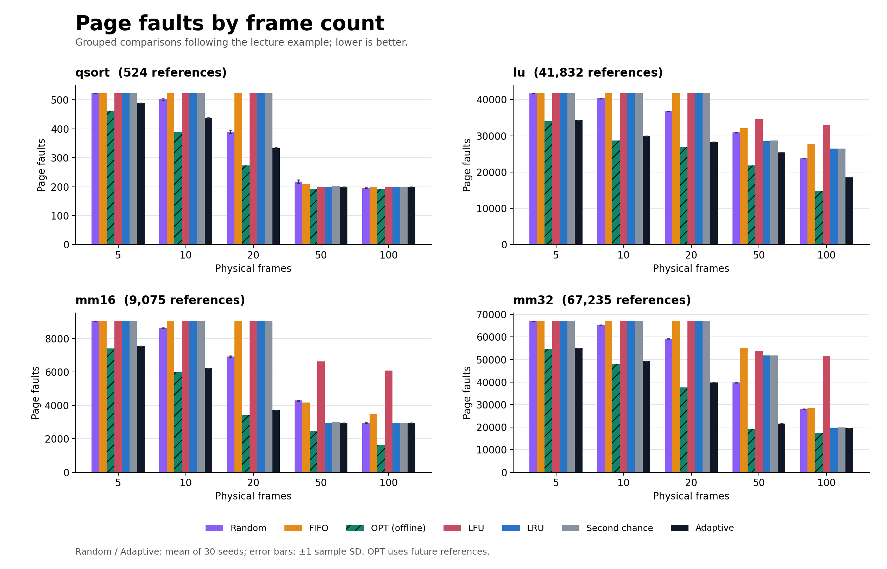
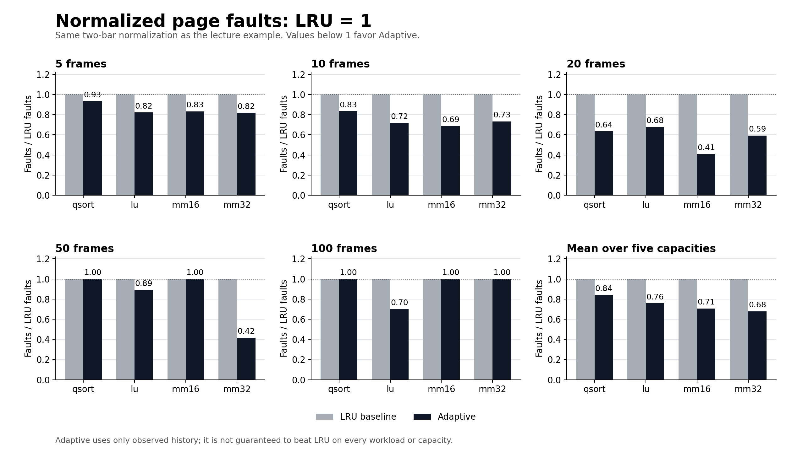
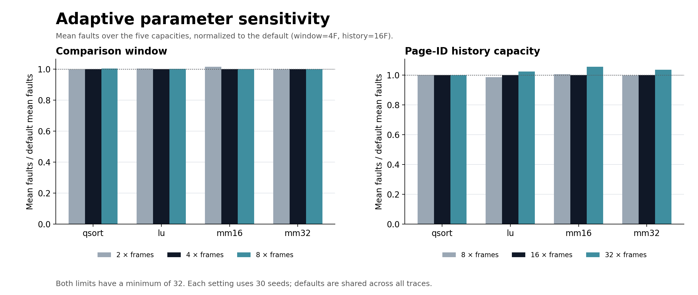
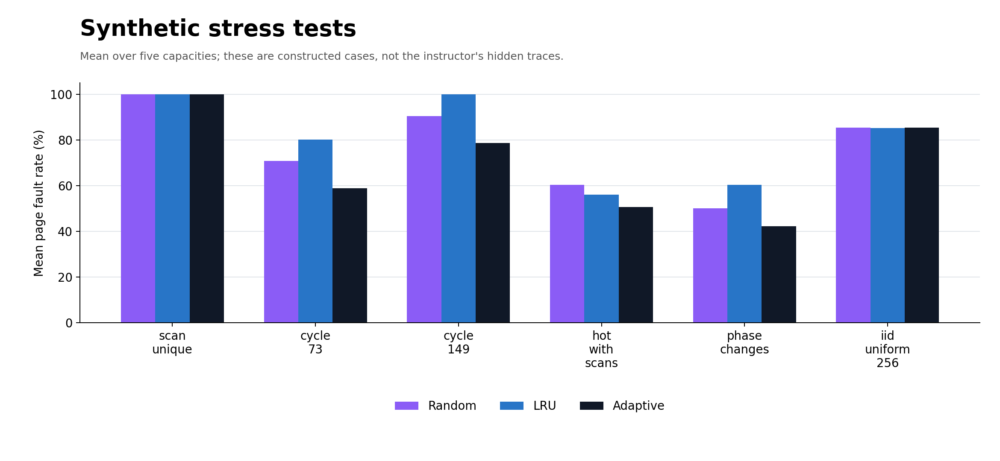
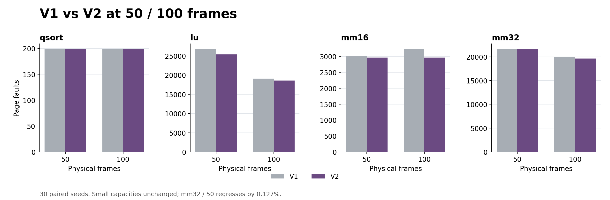

# 自适应页面替换算法与完整实验报告

本次实现一个按容量初始化、根据过去访问表现调整策略的 **Adaptive** 算法，并补齐课件要求的 **Second chance**。同 Random、FIFO、OPT、LFU、LRU 比较，在四条课程轨迹、五档容量的 20 个配置上，Adaptive 的平均缺页次数为 **17,354.63**，比 Random 少 **25.62%**，比 LRU 少 **28.99%**。

与各配置中表现最好的在线基线相比，Adaptive 有 **15 个配置严格更好、3 个持平、2 个落后**。这些是 30 个固定种子的均值比较，不是对未知课堂轨迹的性能保证。OPT 是离线最优参照，Adaptive 的总体平均缺页仍比 OPT 多 **6.41%**。

## 1. 算法如何利用容量和访问特征

一个程序接收页框数 F。小容量（F≤20）以 Random 起步，较大容量以 LRU 起步；后续策略不由文件名、页号或预先知道的轨迹类型决定。

同时维护三个仅含页号的影子模拟器，分别执行 Random、LRU 和历史间隔预测。它们只处理已经发生的访问，用于比较过去一段窗口内的缺页次数。**影子状态没有页面内容，切换策略时不会把影子页面复制进真实内存。真实内存始终只有 F 个页框，只在当前缺页时装入当前页。**

历史间隔预测为最近 H 个不同页号保留末次访问位置和间隔统计，包括已被淘汰的页。一个页再次出现时，用指数平滑更新访问间隔 g 和波动 v（旧统计权重 0.75，新样本权重 0.25）。预测参考间隔为 g+v。若距上次访问的时间还没超过该值，就用剩余间隔评分；若已经逾期，评分改为已经等待的时间，使过时页面逐渐失去保护。没有重复历史的页面优先考虑淘汰，评分相同时选最久未访问的页。这个预测是启发式，不是 OPT 的真实未来位置。

每经过约 W/4 次访问，比较过去 W 次访问中三个影子策略的缺页数。F≤20 时切换门槛为 max(1, floor(W/50))；F>20 时提高到 max(1, floor(W/20))，候选策略必须比当前策略少超过该门槛才切换。比较只用截至前一次访问的结果。

新版 V2 在 F>20 时，每 W 次访问把真实缓存的页号、最近访问位置和随机数状态复制到三个影子模拟器，作为下一轮比较的共同起点。复制方向始终为真实到影子。窗口内部仍允许策略切换，所以这只能减少状态不一致，不能保证影子收益完全兑现。F≤20 保留 V1 规则，避免频繁重置破坏小容量下的预测收益。

默认 H=max(32,16F)。F≤20 时 W=max(32,4F)，F>20 时 W=2×max(32,4F)，所有课程轨迹使用同一组容量规则：

| 页框 F | 初始策略 | 比较窗口 W | 历史页号上限 H |
|---|---|---|---|
| 5 | Random | 32 | 80 |
| 10 | Random | 40 | 160 |
| 20 | Random | 80 | 320 |
| 50 | LRU | 400 | 800 |
| 100 | LRU | 800 | 1600 |

容量越大，算法保留更长的历史、用更长的窗口判断策略表现；但初始策略可以在运行中改变。这不是提前为每条测试轨迹选择最好的算法。

## 2. 实验口径

四条轨迹：qsort（sort1.txt，524 次访问 / 192 个不同页）、lu（41,832 / 531）、mm16（9,075 / 515）、mm32（67,235 / 1,667）。输入已经是十六进制虚拟页号。每次模拟从空内存开始，不预取。

七种方法 × 四条轨迹 × 五档页框数，共 140 组配置。Random 和 Adaptive 各使用种子 0～29，共保存 **1,300 次正式运行**。其余五种算法为确定性算法。LFU 采用驻留期间累计频次、并列按 LRU 决胜；Second chance 采用 Clock 环形指针，新装入和命中都把访问位设为 1。

以下表格中 Random / Adaptive 是 30 次运行的平均缺页次数，所以可能有小数；其他列为精确整数。每次真实运行的整数值、种子、标准差、最小值和最大值均已保存。另提供 [种子 0 的整数表](results/fault_counts_seed0.csv) 和 [完整宽表](results/fault_counts_table.csv)。

## 3. 按课件示例绘制的对比图

课件第 8 页示例采用分组柱状图，并把基准值归一化为 1。这里同时提供绝对缺页次数的分组柱状图，以及 LRU=1 的两柱对比图，避免只看比例而忽略实际数量。

图中 Adaptive 在小容量的优势较明显，mm32 在 50 个页框时也有大幅改善。新版在 mm16 的 50/100 页框和 mm32 的 100 页框上均与 LRU 持平。误差线为 Random / Adaptive 的均值 ±1 个样本标准差，是固定轨迹上随种子变化的波动。

灰柱是 LRU=1，深色柱为 Adaptive/LRU；低于 1 表示 Adaptive 缺页更少。右下角先对五档容量平均缺页次数，再相除。本次所有配置均不差于 LRU，但 qsort/100 仍比 Random 差，也不能据此保证未知轨迹。

## 4. 各方法、各 frame 数的详细缺页次数

### qsort

| Frames | Random | FIFO | OPT | LFU | LRU | Second chance | Adaptive（我们） |
|---|---|---|---|---|---|---|---|
| 5 | 523.10 | 524 | 463 | 524 | 524 | 524 | 489.17 |
| 10 | 502.50 | 524 | 389 | 524 | 524 | 524 | 436.73 |
| 20 | 389.83 | 524 | 274 | 524 | 524 | 524 | 332.80 |
| 50 | 217.67 | 209 | 192 | 199 | 199 | 203 | 199.00 |
| 100 | 196.30 | 199 | 192 | 199 | 199 | 199 | 199.00 |

小容量下历史间隔预测帮助保留即将重用的页面。50、100 个页框时 Adaptive 没有切换，全部使用 LRU；因此均为 199 次。100 个页框下 Random 的均值 196.30 反而更低，说明短轨迹的启动期和窗口长度会影响自适应收益。

单独图：[PNG](results/faults_qsort.png) / [SVG](results/faults_qsort.svg)。

### lu

| Frames | Random | FIFO | OPT | LFU | LRU | Second chance | Adaptive（我们） |
|---|---|---|---|---|---|---|---|
| 5 | 41,708.40 | 41,832 | 34,076 | 41,832 | 41,832 | 41,832 | 34,365.77 |
| 10 | 40,317.50 | 41,832 | 28,722 | 41,832 | 41,832 | 41,832 | 29,995.90 |
| 20 | 36,796.50 | 41,832 | 26,922 | 41,832 | 41,832 | 41,832 | 28,342.80 |
| 50 | 30,923.23 | 32,073 | 21,880 | 34,653 | 28,475 | 28,736 | 25,377.00 |
| 100 | 23,802.27 | 27,864 | 14,869 | 32,969 | 26,497 | 26,483 | 18,584.00 |

Adaptive 在五档容量上都优于在线基线。小容量阶段大部分时间采用间隔预测；50 个页框时在 LRU 和预测之间切换，100 个页框时以预测为主。容量增大仍能显著降低缺页，但与 OPT 的差距表明历史估计尚不能准确捕获所有未来复用。

单独图：[PNG](results/faults_lu.png) / [SVG](results/faults_lu.svg)。

### mm16

| Frames | Random | FIFO | OPT | LFU | LRU | Second chance | Adaptive（我们） |
|---|---|---|---|---|---|---|---|
| 5 | 9,046.63 | 9,075 | 7,407 | 9,075 | 9,075 | 9,075 | 7,552.77 |
| 10 | 8,625.40 | 9,075 | 5,990 | 9,075 | 9,075 | 9,075 | 6,237.77 |
| 20 | 6,922.07 | 9,075 | 3,426 | 9,075 | 9,075 | 9,075 | 3,707.67 |
| 50 | 4,292.07 | 4,180 | 2,461 | 6,642 | 2,964 | 3,023 | 2,964.00 |
| 100 | 2,963.97 | 3,487 | 1,657 | 6,077 | 2,964 | 2,964 | 2,964.00 |

5、10、20 个页框保留原有收益。50、100 个页框新版均为 2,964 次，与 LRU 持平，修复了旧版对应的 3,013 和 3,231.33 次退化。

单独图：[PNG](results/faults_mm16.png) / [SVG](results/faults_mm16.svg)。

### mm32

| Frames | Random | FIFO | OPT | LFU | LRU | Second chance | Adaptive（我们） |
|---|---|---|---|---|---|---|---|
| 5 | 67,071.20 | 67,235 | 54,807 | 67,235 | 67,235 | 67,235 | 55,009.90 |
| 10 | 65,301.03 | 67,235 | 48,109 | 67,235 | 67,235 | 67,235 | 49,259.47 |
| 20 | 59,191.53 | 67,235 | 37,682 | 67,235 | 67,235 | 67,235 | 39,837.93 |
| 50 | 39,745.63 | 55,136 | 19,164 | 53,805 | 51,860 | 51,865 | 21,633.00 |
| 100 | 28,090.60 | 28,421 | 17,514 | 51,699 | 19,604 | 19,947 | 19,604.00 |

50 个页框时新版缺页 21,633 次，明显低于 Random 的 39,745.63 和 LRU 的 51,860，但比旧版 21,605.63 略多 0.127%。100 个页框新版为 19,604 次，与 LRU 持平。

单独图：[PNG](results/faults_mm32.png) / [SVG](results/faults_mm32.svg)。

## 5. 总体平均与统计方式

| 方法 | 20 个配置平均缺页次数 | 宏平均缺页率 |
|---|---|---|
| OPT | 16,309.80 | 54.25% |
| Adaptive（我们） | 17,354.63 | 58.83% |
| Random | 23,331.37 | 75.04% |
| LRU | 24,438.00 | 78.95% |
| Second chance | 24,470.90 | 79.07% |
| FIFO | 25,378.35 | 81.50% |
| LFU | 27,112.05 | 86.73% |

先对随机算法的种子取平均，再对四条轨迹 × 五档容量等权平均。原始缺页次数的平均更受长轨迹数值大小影响；宏平均缺页率先除以各自访问次数，再等权平均。两种指标没有混用。

## 6. 参数变化实验

分别改变比较窗口因子 2、4、8（历史因子固定 16），以及历史因子 8、16、32（窗口因子固定 4）。每种设置都覆盖四条轨迹、五档容量、30 个种子，共 3,000 条参数实验记录，其中默认设置复用正式实验的 600 条记录。

| 窗口因子 | 历史因子 | qsort | lu | mm16 | mm32 | 总体平均 |
|---|---|---|---|---|---|---|
| 2 | 16 | 330.68 | 27,468.23 | 4,757.05 | 37,063.37 | 17,404.84 |
| 4 | 16 | 331.34 | 27,333.09 | 4,685.24 | 37,068.86 | 17,354.63 |
| 8 | 16 | 332.81 | 27,420.85 | 4,691.05 | 37,074.92 | 17,379.91 |
| 4 | 8 | 331.34 | 26,965.03 | 4,715.97 | 36,978.46 | 17,247.70 |
| 4 | 32 | 331.34 | 27,985.34 | 4,945.36 | 38,390.53 | 17,913.14 |

表内每条轨迹先平均五档容量。V2 在 F>20 时对窗口再乘 2。默认 4/16 与容量规则通过已知课程轨迹的探索确定；本表属于参数敏感性分析，不能当作未见数据上的证据。没有按文件名或页号选择参数。

## 7. 构造轨迹回归测试

补充六类压力测试：纯顺序扫描、73 页循环、149 页循环、热点夹杂扫描、访问阶段切换、256 页均匀独立随机访问。每类仍测试五档容量和七种算法，随机算法各 30 个种子，共 1,950 次运行。轨迹由脚本确定性生成，保留文件和校验值。这些数据不是老师的隐藏测试集，不能代替现场验证。

| 构造轨迹 | Random | LRU | OPT | Adaptive |
|---|---|---|---|---|
| scan_unique | 6,000.00 | 6,000.00 | 6,000.00 | 6,000.00 |
| cycle_73 | 4,257.13 | 4,814.60 | 3,475.20 | 3,534.46 |
| cycle_149 | 5,433.47 | 6,000.00 | 4,564.00 | 4,726.73 |
| hot_with_scans | 3,482.57 | 3,233.20 | 2,761.80 | 2,921.95 |
| phase_changes | 3,003.87 | 3,627.40 | 2,414.00 | 2,540.56 |
| iid_uniform_256 | 5,125.00 | 5,117.00 | 3,681.00 | 5,124.05 |

表中是五档容量平均缺页次数，图中是平均缺页率。纯扫描没有复用，所有方法均缺页 6,000 次。六条构造轨迹在 V1 阶段已经看过，本次只作为回归测试，不能称为全新验证集；V2 参数固定后重新运行，未据此进一步调参。课堂的新轨迹仍需现场评测。

## 8. 开销与局限

Adaptive 维护真实缓存 F 个页框、三个影子缓存的页号元数据、最多 H 个历史页号，以及 W 条三策略缺页记录。默认参数下额外元数据为 O(F)，并非零开销；影子缓存不占用额外的真实页面内容。每次访问期望 O(1) 更新历史；真实或影子策略需要选择 LRU/预测淘汰对象时会扫描 F 个页框，整个模拟的期望上界为 O(NF)。

下表是在相同 WSL 环境的 Release 可执行程序上，运行 mm32 / 100 个页框 / seed=0 的端到端耗时。每种方法预热一次，再以打乱顺序测量 10 次。包含进程启动、输入解析和模拟，不是实际操作系统的缺页处理延迟。

| 方法 | 耗时中位数（ms） | 最小值 | 最大值 |
|---|---|---|---|
| Random | 14.32 | 12.57 | 22.40 |
| FIFO | 25.96 | 24.45 | 35.63 |
| OPT | 21.34 | 19.31 | 23.43 |
| LFU | 21.75 | 20.13 | 25.53 |
| LRU | 20.61 | 19.82 | 25.54 |
| Second chance | 13.65 | 11.78 | 17.64 |
| Adaptive（我们） | 64.24 | 60.67 | 69.76 |

Adaptive 的模拟开销明显高于简单基线，这是维护影子策略和间隔预测的代价。优化缺页次数不等于使模拟器本身运行更快。策略选择还有窗口滞后、预测错误和真实/影子缓存状态不一致等限制，没有对任意未知轨迹优于全部基线的保证。

## 9. 正确性与复现

Release、AddressSanitizer 和 UndefinedBehaviorSanitizer 测试通过。算法测试共 1,639,425 项检查，包括 1,093 条小轨迹 × 四档测试容量 × 七种算法，OPT 对照独立穷举最优解，Second chance 对照队列参考实现。另验证 V1/V2 在 F≤20 时逐步决策一致。

增加了在线前缀不变性检查：截断未来后缀时，前面的命中、页框和淘汰决定保持一致。另检查页号重命名不变性、随机种子复现、策略切换后的物理容量约束、历史上限与参数范围。正式实验验证 OPT 下界、LRU/OPT 容量单调性，并做了 28 次足够内存检查；真实轨迹的 LRU 结果也与独立重用距离计算一致。

复现命令见 [README](README.md)。[raw.csv](results/raw.csv) 保存全部正式运行，[summary.csv](results/summary.csv) 保存每组均值、标准差和极值；[parameters_raw.csv](results/parameters_raw.csv)、[synthetic_raw.csv](results/synthetic_raw.csv) 保存补充实验原始记录。所有图均附 PNG 和 SVG，可直接插入汇报 PPT。

现有四条课程轨迹已用于理解访问规律，因此不能把它们称为真正未见的泛化评测。课堂新轨迹必须按输入顺序运行，不能预扫未来频次或下一次访问位置；只有 OPT 基线允许使用未来信息。

## 10. 本轮优化前后对照

V1 总体平均 17,478.11，V2 为 17,354.63，进一步降低 0.706%。20 个配置中 5 个改善、14 个完全一致、1 个轻微退化。

| 轨迹 | Frames | V1 | V2 | 缺页变化 |
|---|---|---|---|---|
| qsort | 5 | 489.17 | 489.17 | +0.00 |
| qsort | 10 | 436.73 | 436.73 | +0.00 |
| qsort | 20 | 332.80 | 332.80 | +0.00 |
| qsort | 50 | 199.00 | 199.00 | +0.00 |
| qsort | 100 | 199.00 | 199.00 | +0.00 |
| lu | 5 | 34,365.77 | 34,365.77 | +0.00 |
| lu | 10 | 29,995.90 | 29,995.90 | +0.00 |
| lu | 20 | 28,342.80 | 28,342.80 | +0.00 |
| lu | 50 | 26,784.00 | 25,377.00 | -1,407.00 |
| lu | 100 | 19,089.57 | 18,584.00 | -505.57 |
| mm16 | 5 | 7,552.77 | 7,552.77 | +0.00 |
| mm16 | 10 | 6,237.77 | 6,237.77 | +0.00 |
| mm16 | 20 | 3,707.67 | 3,707.67 | +0.00 |
| mm16 | 50 | 3,013.00 | 2,964.00 | -49.00 |
| mm16 | 100 | 3,231.33 | 2,964.00 | -267.33 |
| mm32 | 5 | 55,009.90 | 55,009.90 | +0.00 |
| mm32 | 10 | 49,259.47 | 49,259.47 | +0.00 |
| mm32 | 20 | 39,837.93 | 39,837.93 | +0.00 |
| mm32 | 50 | 21,605.63 | 21,633.00 | +27.37 |
| mm32 | 100 | 19,872.00 | 19,604.00 | -268.00 |

保留 `--adaptive-version 1` 可复现旧版，默认是 2。[versions_raw.csv](results/versions_raw.csv) 保存相同种子下两版的 1,200 条记录。探索阶段先在种子 0～4 上比较重置周期、窗口与门槛，再固定容量规则并用 0～29 完整复测。已知课程数据参与了选择，收益只是本数据上的实测结果。
