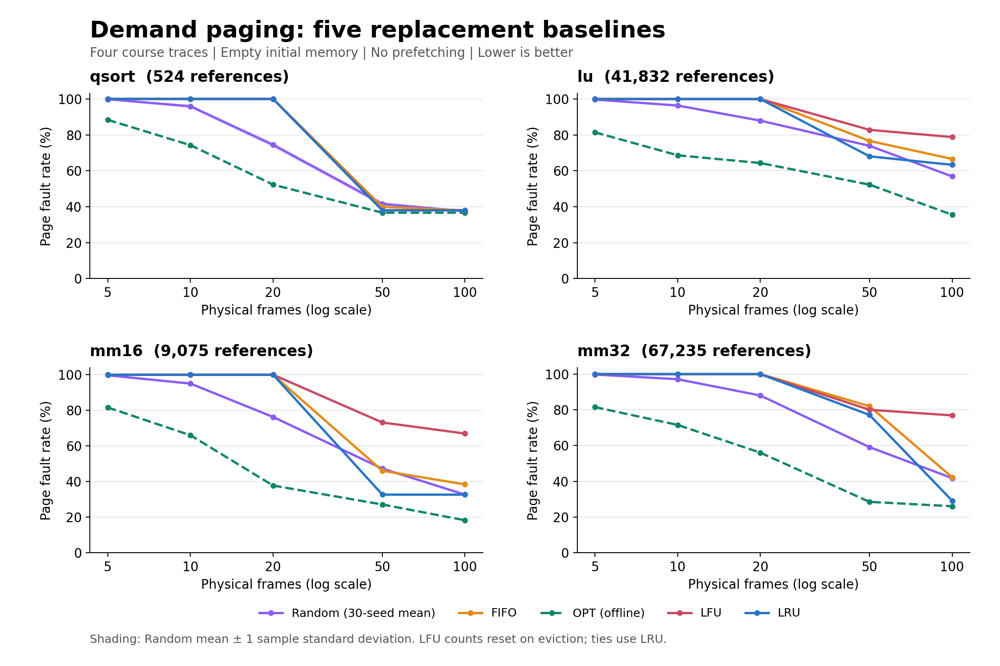

# 页面替换五种基线实验报告

本次完成 Random、FIFO、MIN/OPT、LFU、LRU 五种基线，在课程给定的四条 trace 和五档页框数上进行比较。**OPT 在全部配置中达到最少缺页。四种在线算法按全部配置的平均缺页次数排序为 Random、LRU、FIFO、LFU，但单个配置的最优算法会变化。**

## 1. 实验设置

| 项目 | 设置 |
|---|---|
| trace | qsort（文件名 sort1.txt）、lu、mm16、mm32 |
| 页框数量 F | 5、10、20、50、100 |
| 初始状态 | 每次模拟的内存为空 |
| 装入规则 | 只在当前页面缺页时装入；内存满时才淘汰；不预取 |
| 页面标识 | trace 已给出十六进制虚拟页号，不再做地址换算 |
| 核心指标 | 缺页次数；辅助展示缺页率 = 缺页次数 / 访问次数 |
| Random | 固定种子 0～29，共 30 次；报告均值、样本标准差、最小值和最大值 |
| 确定性算法 | 每个配置运行一次 |
| LFU 口径 | 当前驻留期间累计次数；装入为 1，淘汰丢弃；并列按 LRU |
| OPT 口径 | 利用完整 trace 计算下一次访问，作为离线最优基准 |
| 实验规模 | 100 组配置，680 次正式运行，另有 20 次足够内存检查 |
| 环境 | Ubuntu 24.04 / WSL2，GCC 13.3.0，C++17，Release 构建 |

算法规则、实现开销和运行命令见 [README](README.md)。源数据保持原始字节，并记录在 [校验清单](data/manifest.json) 中。实验脚本记录每次结果，不选择 Random 的最佳种子代替平均表现。

## 2. 总体结果

下面对 4 条 trace × 5 档页框数的 **20 个配置等权平均**。先对每个 Random 配置平均 30 个种子，再与其他算法一样平均 20 个配置。

| 算法 | 平均缺页次数 | 宏平均缺页率 |
|---|---:|---:|
| OPT（离线） | 16,309.80 | 54.25% |
| Random | 23,331.37 | 75.04% |
| LRU | 24,438.00 | 78.95% |
| FIFO | 25,378.35 | 81.50% |
| LFU | 27,112.05 | 86.73% |

Random 的平均缺页次数比 LRU 少约 **4.53%**。这个结论仅适用于本次给定数据与页框配置，不说明 Random 对任意工作负载都更优。原始缺页次数的平均会受长 trace 的数量级影响；宏平均缺页率先将每个配置除以其访问次数，再等权平均，不能与汇总全部访问后的加权缺页率混用。

图中横轴为对数刻度，但刻度值是真实页框数量。阴影表示 Random 的均值 ±1 个样本标准差，是固定 trace 上的随机种子波动，不是对未知工作负载的置信区间。多条线重叠表示结果相同。下面分别给出各 trace 的数值和趋势分析。

## 3. 每条 trace 的结果

表内数值均为缺页次数，Random 用“均值 ± 样本标准差”；其余算法为精确整数。

### qsort：524 次访问，192 个不同页面

| 页框 | Random | FIFO | OPT | LFU | LRU |
|---:|---:|---:|---:|---:|---:|
| 5 | 523.10 ± 0.88 | 524 | 463 | 524 | 524 |
| 10 | 502.50 ± 3.57 | 524 | 389 | 524 | 524 |
| 20 | 389.83 ± 6.24 | 524 | 274 | 524 | 524 |
| 50 | 217.67 ± 5.93 | 209 | 192 | 199 | 199 |
| 100 | 196.30 ± 1.24 | 199 | 192 | 199 | 199 |

20 增至 50 个页框时，LRU/LFU 从每次缺页下降到 199 次。OPT 在 50 个页框时达到 192 次，即每个不同页仅首次访问缺页。达到这个下界不要求同时容纳全部 192 个页面，因为已经不再使用的页面可以及时淘汰。50 个页框下 LRU/LFU 优于 Random，100 个页框下 Random 的平均值更低。

### lu：41,832 次访问，531 个不同页面

| 页框 | Random | FIFO | OPT | LFU | LRU |
|---:|---:|---:|---:|---:|---:|
| 5 | 41,708.40 ± 9.32 | 41,832 | 34,076 | 41,832 | 41,832 |
| 10 | 40,317.50 ± 37.50 | 41,832 | 28,722 | 41,832 | 41,832 |
| 20 | 36,796.50 ± 51.63 | 41,832 | 26,922 | 41,832 | 41,832 |
| 50 | 30,923.23 ± 49.21 | 32,073 | 21,880 | 34,653 | 28,475 |
| 100 | 23,802.27 ± 67.80 | 27,864 | 14,869 | 32,969 | 26,497 |

50 个页框时 LRU 是四个在线基线中最好的；增加到 100 个后，Random 更好。100 个页框下 LFU 仍有约 78.81% 的访问缺页，说明这里的驻留期累计频次不能有效预测后续需要保留的页面。Random 与 OPT 之间仍有较大的差距。

### mm16：9,075 次访问，515 个不同页面

| 页框 | Random | FIFO | OPT | LFU | LRU |
|---:|---:|---:|---:|---:|---:|
| 5 | 9,046.63 ± 4.92 | 9,075 | 7,407 | 9,075 | 9,075 |
| 10 | 8,625.40 ± 17.68 | 9,075 | 5,990 | 9,075 | 9,075 |
| 20 | 6,922.07 ± 41.22 | 9,075 | 3,426 | 9,075 | 9,075 |
| 50 | 4,292.07 ± 31.81 | 4,180 | 2,461 | 6,642 | 2,964 |
| 100 | 2,963.97 ± 24.94 | 3,487 | 1,657 | 6,077 | 2,964 |

LRU 从 20 到 50 个页框时大幅改善，但从 50 到 100 时缺页次数保持 2,964。这意味着增加的页框没有覆盖到新的 LRU 可命中重用距离；它不表示所有算法都无法获益，OPT 在同一区间从 2,461 降至 1,657。100 个页框下 Random 的均值只比 LRU 少约 0.03 次，远小于其标准差，不能据此声称有可靠优势。

### mm32：67,235 次访问，1,667 个不同页面

| 页框 | Random | FIFO | OPT | LFU | LRU |
|---:|---:|---:|---:|---:|---:|
| 5 | 67,071.20 ± 11.72 | 67,235 | 54,807 | 67,235 | 67,235 |
| 10 | 65,301.03 ± 35.19 | 67,235 | 48,109 | 67,235 | 67,235 |
| 20 | 59,191.53 ± 73.40 | 67,235 | 37,682 | 67,235 | 67,235 |
| 50 | 39,745.63 ± 124.91 | 55,136 | 19,164 | 53,805 | 51,860 |
| 100 | 28,090.60 ± 101.89 | 28,421 | 17,514 | 51,699 | 19,604 |

50 个页框时 Random 明显领先其他在线基线。增至 100 个时，LRU 降到 19,604 次，比 Random 的均值少约 30.21%，也接近 OPT 的 17,514 次。这个反转说明页框数量会改变适合的策略，仅按总体平均值选择算法会忽略这种差异。LFU 在 100 个页框时仍有 51,699 次缺页，本实现没有历史热度衰减；旧高频页滞留是可能的机制解释，汇总结果本身不足以逐次确认其因果贡献。

## 4. 为什么小内存下三个算法都是 100% 缺页

对四条原始 trace 独立计算了**重用距离**：同一页面两次相邻访问之间出现的不同页面数。四条 trace 的最小重用距离都是 **20**，详见 [trace_diagnostics.json](results/trace_diagnostics.json)。

对于 F 个页框的 LRU，一次重复访问命中的条件是重用距离 **小于 F**。因此 F 为 5、10、20 时，所有重复访问都会缺页，首次访问也必然缺页，总缺页次数恰好等于 trace 长度。这个结果已使用独立的重用距离统计与模拟器逐档交叉验证。

在从空内存开始、一直不命中的这段访问过程中，FIFO 与 LRU 的淘汰顺序相同。本实现 LFU 的驻留计数又始终为 1，并列按 LRU 决定，因此三个算法都持续缺页。

Random 没有固定淘汰最老页面；一个页面有可能连续多次没有被随机选中，一直保留到下次访问，因此即使页框数不足以让 LRU 命中，也可能获得命中。OPT 则利用未来访问的信息，有目的地保留将要重用的页面，所以在相同容量下能显著减少缺页。

## 5. 按课件平均方式比较

下表对每条 trace 分别平均五档页框数，单位仍是缺页次数：

| trace | Random | FIFO | OPT | LFU | LRU |
|---|---:|---:|---:|---:|---:|
| qsort | 365.88 | 396.00 | 302.00 | 394.00 | 394.00 |
| lu | 34,709.58 | 37,086.60 | 25,293.80 | 38,623.60 | 36,093.60 |
| mm16 | 6,370.03 | 6,978.40 | 4,188.20 | 7,988.80 | 6,630.60 |
| mm32 | 51,880.00 | 57,052.40 | 35,455.20 | 61,441.80 | 54,633.80 |

Random 在四条已给 trace 的五档容量平均值上均优于其他在线基线。但未知测试 trace 的访问规律可能不同，不能据此预言现场排名。OPT 的结果只作为离线参照。

## 6. 验证与可复现性

- Release 与 AddressSanitizer / UndefinedBehaviorSanitizer 构建均通过 CTest 的算法与 CLI 测试。
- 算法测试完成 833,674 项检查，包含全部 1,093 条长度 0～6、三种页号的小 trace，在 1～4 个页框下测试五种算法。
- OPT 与枚举每一种合法淘汰选择得到的最优缺页次数一致；FIFO、LRU、LFU 每次淘汰与独立参考实现一致。
- 680 次正式运行均满足命中/缺页记账、OPT 下界、冷启动缺页下界与淘汰次数关系；LRU 和 OPT 在增加容量时没有出现缺页数增加。
- 对每条真实 trace，额外将页框数设为不同页面数。五种算法均恰好缺页 U 次、淘汰 0 次，共 20 项检查。
- 独立重用距离分析再次核对四条 trace、五档容量下的全部 LRU 缺页数。

完整复现命令见 [README](README.md)。[raw.csv](results/raw.csv) 保存 680 行原始统计，[summary.csv](results/summary.csv) 保存 100 行汇总。[metadata.json](results/metadata.json) 记录源文件、二进制和 trace 校验值、种子与环境；图表同时提供 PNG 和可缩放 SVG。

本报告衡量页面替换策略的缺页表现，不包含真实磁盘延迟、写回成本或应用执行时间。Second chance 与自设算法是课件的其他要求，不在本次五基线交付范围内。
